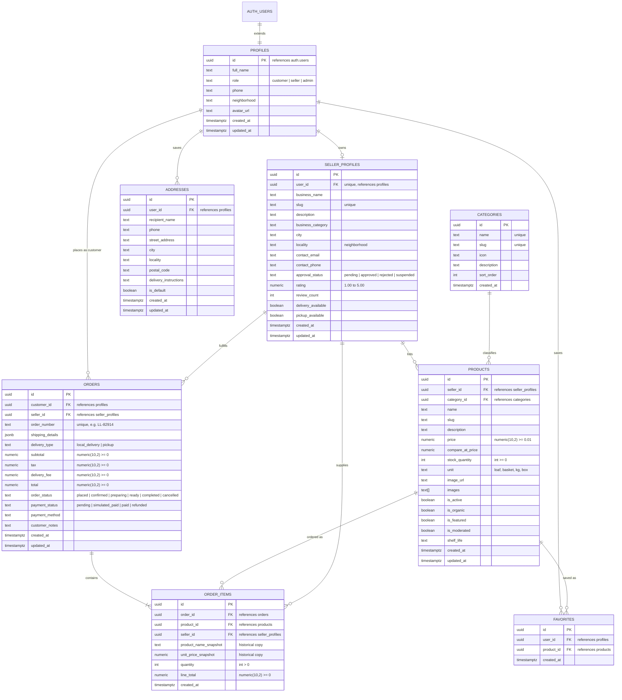

# LocalLoop: Production Database Architecture & Supabase Guide

This document outlines the database design, entity relationships, Row Level Security (RLS) model, and setup instructions for the **LocalLoop** hackathon MVP.

---

## 1. Entity-Relationship Diagram (ERD)



---

## 2. Architectural Design Decisions & Integrity Rules

### Fixed-Precision Currency & Quantities
- All prices, subtotals, taxes, and totals strictly use **`numeric(10, 2)`**. Floating point types (`float`, `real`, `double precision`) are banned to eliminate rounding drift.
- Quantity fields strictly enforce `check (quantity > 0)`.
- Available stock strictly enforces `check (stock_quantity >= 0)`. Any operation that would produce negative inventory is automatically aborted at the engine level.

### Historical Audit Snapshots (`order_items`)
- Rather than joining to `products` at invoice time, `order_items` stores:
  - `product_name_snapshot`: Exact name of the item at the moment of order.
  - `unit_price_snapshot`: Exact price charged at purchase.
- If a baker raises the price of sourdough from $7.50 to $8.50 next week, prior customer orders and seller earnings reports remain 100% accurate.

### Atomic Concurrency & Overselling Prevention
- Order creation is executed through the stored procedure **`create_order_atomic`** with `SECURITY DEFINER`.
- Inside the transaction, products are sorted by `id` and locked with **`SELECT ... FOR UPDATE`**.
- This guarantees that two shoppers checking out the final loaf of sourdough simultaneously cannot oversell the inventory; one transaction acquires the row lock, checks `stock_quantity >= quantity`, decrements the stock, and commits; the second transaction then wakes up, sees `stock_quantity = 0`, and raises a friendly `Insufficient stock` exception.

### Server-Authoritative Totals
- The client cart only supplies `{ product_id, quantity }`. Client-computed totals are **completely ignored**.
- The database recalculates unit price $\times$ quantity, checks seller ownership, applies standard 8% sales tax, and determines delivery fees (free if pickup or $\ge \$35$, else $\$3.50$).

### Anti-Privilege Escalation Triggers
- Role escalation is prevented via trigger: a customer cannot send `UPDATE profiles SET role = 'admin'` — the trigger checks `public.is_admin()` and halts the transaction.
- Sellers cannot self-approve their storefront; only an admin can advance `approval_status` from `pending` to `approved`.

---

## 3. Row Level Security (RLS) Permission Matrix

| Table | Public / Guest | Customer | Seller | Admin |
| :--- | :--- | :--- | :--- | :--- |
| **`profiles`** | Denied | Read/Update own profile | Read/Update own profile | Full Access (Read/Update all) |
| **`seller_profiles`** | Read approved only | Read approved only | Read/Update own storefront | Full Access (Verify / Suspend) |
| **`categories`** | Read only | Read only | Read only | Full Access |
| **`products`** | Read active & approved | Read active & approved | CRUD own storefront products | Full Access (Moderate / Delist) |
| **`addresses`** | Denied | CRUD own addresses | CRUD own addresses | Read all |
| **`orders`** | Denied | View own orders, cancel if `placed` | View orders for own store, advance permitted statuses | Full Access |
| **`order_items`** | Denied | View items of own orders | View items of store orders | Full Access |
| **`favorites`** | Denied | CRUD own favorites | CRUD own favorites | Full Access |

---

## 4. Setup Instructions for a Fresh Supabase Project

### Option A: Using the Supabase Web Dashboard (Easiest & Recommended)
1. Go to [database.new](https://database.new) and create a free project.
2. In the Supabase Dashboard, navigate to the **SQL Editor** (icon `>_` on the left sidebar).
3. Click **New Query**.
4. Open the consolidated file [`supabase/schema.sql`](file:///d:/Aaaaaaaaaaaaaaa/supabase/schema.sql) in this repository, copy its entire contents, paste it into the SQL Editor, and click **Run**.
5. Once executed, open [`supabase/seed.sql`](file:///d:/Aaaaaaaaaaaaaaa/supabase/seed.sql), paste into a New Query, and click **Run** to seed sample verified sellers and products.
6. Under **Project Settings ➔ API**, copy:
   - `Project URL`
   - `Project API anon public key`
7. In your local project directory `d:\Aaaaaaaaaaaaaaa\`, create a `.env` file:
   ```env
   VITE_SUPABASE_URL=https://your-project-id.supabase.co
   VITE_SUPABASE_ANON_KEY=eyJhbGciOi...
   ```
8. Restart your dev server (`npm run dev`). LocalLoop will automatically detect the credentials and switch to live Supabase mode!

---

### Option B: Using the Supabase CLI (Local Development)
1. Initialize and start local Supabase containers (requires Docker):
   ```bash
   npx supabase init
   npx supabase start
   ```
2. Apply the versioned migrations in order:
   ```bash
   npx supabase migration up
   ```
3. Seed the local database:
   ```bash
   npx supabase db reset
   ```
4. Copy the local API credentials into `.env`:
   ```env
   VITE_SUPABASE_URL=http://localhost:54321
   VITE_SUPABASE_ANON_KEY=eyJhbGciOi...
   ```

---

## 5. SQL Verification & Test Suite Execution

To verify all constraints, permissions, and atomic order triggers, paste the contents of [`supabase/tests/localloop_test_suite.sql`](file:///d:/Aaaaaaaaaaaaaaa/supabase/tests/localloop_test_suite.sql) into the Supabase SQL Editor and click **Run**.

It automatically verifies:
- ✅ **Test 1:** Negative stock and price rejection.
- ✅ **Test 2:** Anti-role escalation trigger halts unauthorized admin elevation.
- ✅ **Test 3:** Anti-seller self-approval trigger blocks storefront status tampering.
- ✅ **Test 4:** `create_order_atomic` creates parent orders, line items, historical snapshots, and decrements stock.
- ✅ **Test 5:** Concurrency safety: orders exceeding available stock are rejected.
- ✅ **Test 6:** Permitted status transitions and automatic stock restoration upon cancellation.
